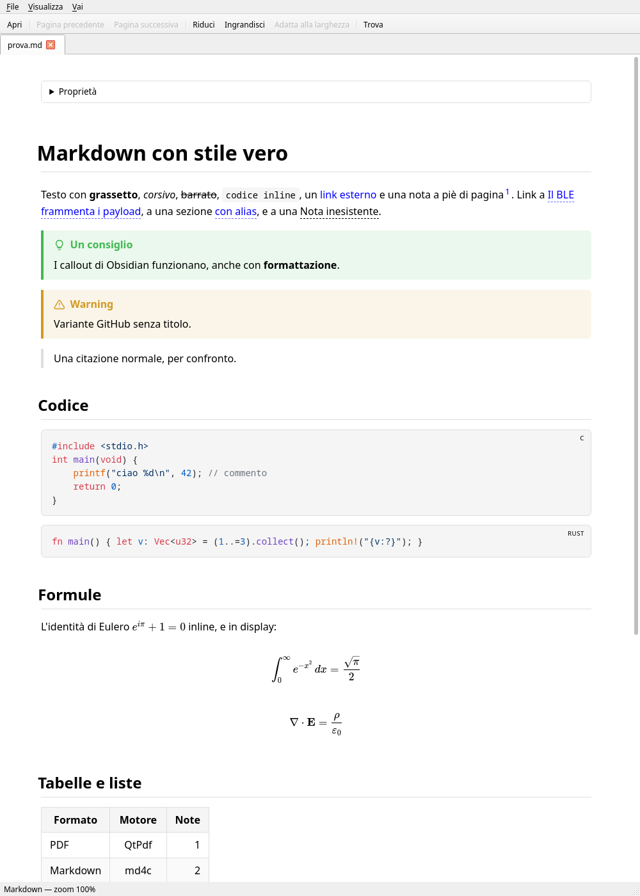
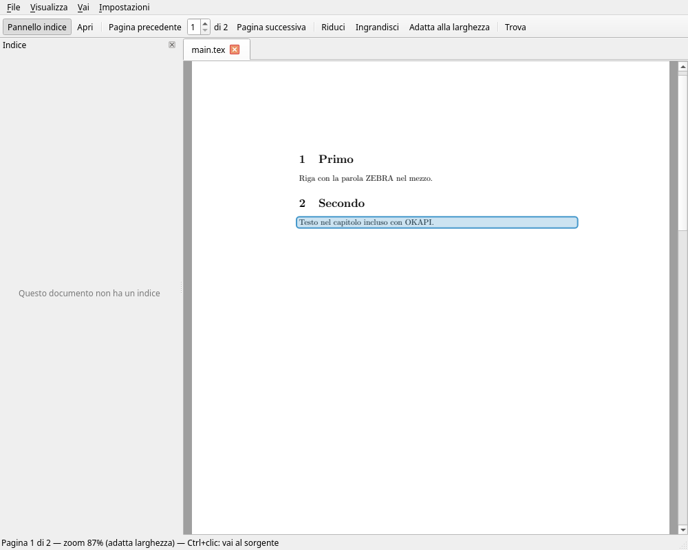
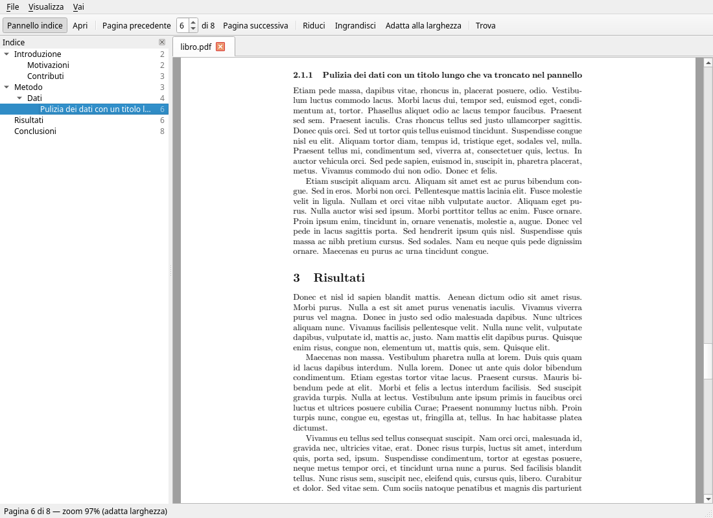

# DisOkular

A desktop document reader for **PDF**, **Markdown** and **LaTeX** that also opens **images**,
written in C++17 with Qt 6.

LaTeX sources are compiled in the background and displayed as PDF, with SyncTeX in both
directions and automatic bibliography generation. Markdown is rendered with full CSS, code
highlighting and math, and understands Obsidian vaults (wikilinks, embeds, callouts,
front matter). The user interface is in Italian.



## Features

### PDF
- Continuous scrolling, zoom, fit to width, page navigation
- Text search with highlighted results
- Outline panel built from the document bookmarks, following the reading position

### Markdown
- GitHub-flavoured Markdown: tables, task lists, footnotes, strikethrough, autolinks
- Syntax highlighting (highlight.js) and math with `$…$`, `$$…$$` and ```` ```math ```` (KaTeX)
- Callouts in both Obsidian (`> [!tip] Title`) and GitHub (`> [!WARNING]`) syntax
- Obsidian support: `[[Note]]`, `[[Note#Heading|alias]]`, `![[image.png|300]]` are resolved
  across the whole vault (the folder containing `.obsidian`); YAML front matter is shown as
  a collapsible "Properties" box; links to missing notes are shown greyed out
- Colours follow the system palette, so light and dark themes work out of the box
- Outline panel built from the headings
- Scripts embedded in a document never run: JavaScript is disabled for page content, and
  the renderer's own scripts run in an isolated world

### LaTeX
- Compiles with `pdflatex` by default; pick another engine with a magic comment on one of
  the first lines: `% !TEX program = xelatex` (or `lualatex`)
- Output goes to a temporary directory, so no `.aux`/`.log` files end up next to your sources
- Runs extra passes automatically when cross-references change
- **Bibliography**: runs `bibtex` (or `biber` for biblatex) after the first pass, then the
  extra passes needed. It reruns only when citations or `.bib` files change
- Compile errors are shown in a panel below the document, with `file:line: message` first
- **SyncTeX**: Ctrl+click on the PDF opens your editor at the matching source line, and
  `disokular --forward LINE file.tex` scrolls the PDF to a source line and highlights it.
  Files included with `\input`/`\include` are handled



### Images
- PNG, JPEG, GIF, WebP, SVG/SVGZ, BMP, TIFF, TGA, ICO and the other formats the installed Qt
  image plugins can read. The list is queried at runtime, so installing `kimageformats` adds
  AVIF, JPEG XL, HEIF and more without rebuilding
- Animated GIF and WebP, with Space to pause and resume and the frame number in the status bar
- Fit to window by default (photos are never upscaled; SVGs are), Ctrl+wheel zoom around the
  cursor, drag to pan, double-click to toggle between fit and 100%
- SVGs are redrawn at every zoom level, so they stay sharp; pixel art stays crisp when magnified
- Checkerboard behind transparent areas; EXIF orientation applied to photos
- "Copy image" from the context menu

### General
- Tabs, drag and drop, fullscreen
- Automatic reload when a file changes on disk. For LaTeX this includes included chapters
  and `.bib` files
- Welcome page with the history of opened documents (filterable, with relative dates)
- Single instance: opening a file from the command line, or a forward search triggered by
  your editor, goes to the running window



## Building

### Dependencies

| Component | Used for | Arch Linux package |
|---|---|---|
| Qt ≥ 6.8: Widgets, Network | UI, single-instance socket | `qt6-base` |
| Qt SVG | SVG images | `qt6-svg` |
| Qt image format plugins (optional) | WebP, TIFF, TGA, ICNS… | `qt6-imageformats` |
| Qt PDF, Qt WebEngine | PDF rendering, Markdown view | `qt6-webengine` |
| md4c (with md4c-html) | Markdown → HTML | `md4c` |
| libsynctex | SyncTeX | `libsynctex` |
| CMake ≥ 3.21, a C++17 compiler | Build | `cmake`, `ninja`, `gcc` |

At runtime, LaTeX documents also need a TeX distribution (`pdflatex`, `bibtex`), e.g. on Arch
`texlive-basic texlive-latex texlive-latexrecommended`. For biblatex documents you also
need `biber` and `texlive-bibtexextra`.

highlight.js 11.11.1 and KaTeX 0.16.22 are vendored in `third_party/` and compiled into the
binary as Qt resources, so no network access is needed at runtime.

### Quick install

`install.sh` checks the dependencies, builds a Release binary and installs it:

```sh
./install.sh                 # into ~/.local, no root needed
./install.sh --system        # into /usr/local, using sudo
./install.sh --set-default   # also make DisOkular the default app for PDF, Markdown and LaTeX
./install.sh --uninstall     # removes what the last install put in place
./install.sh --help          # all options: --prefix, --build-type, --build-dir, --jobs, --clean
```

Besides the binary, the install adds a desktop entry (`share/applications/disokular.desktop`)
and an icon (`share/icons/hicolor/scalable/apps/disokular.svg`), so DisOkular shows up in
application launchers and in "Open with" menus. The binary itself is self-contained:
stylesheets, scripts and fonts are compiled in as Qt resources.

`--set-default` changes the per-user associations in `~/.config/mimeapps.list` for
`application/pdf`, `text/markdown` and `text/x-tex`. Images appear in "Open with" menus but
your default image viewer is left alone. The previous defaults are saved first,
and `--uninstall` puts them back exactly as they were.

### Build and run manually

```sh
cmake -B build -G Ninja -DCMAKE_BUILD_TYPE=Release
cmake --build build
./build/disokular document.pdf notes.md thesis.tex
```

Install with `cmake --install build` (the binary goes to `<prefix>/bin`).

## Usage

```
disokular [file...]
disokular --forward LINE[:COLUMN] source.tex [main.tex|main.pdf]
disokular --new-instance [file...]
```

- `--forward`: SyncTeX forward search. If `main` is omitted, DisOkular uses the open LaTeX
  document that includes `source.tex`, or opens `source.tex` itself. A `.pdf` main file is
  mapped to the `.tex` with the same name.
- `--new-instance`: open a separate window instead of sending the files to the running one.

### Keyboard shortcuts

| Action | Shortcut |
|---|---|
| Open | Ctrl+O |
| Reload | F5 |
| Close tab | Ctrl+W |
| Find / next / previous | Ctrl+F, then Enter / Shift+Enter; Esc closes |
| Zoom in / out / reset | Ctrl++ / Ctrl+- / Ctrl+0 (images: also Ctrl+wheel) |
| Fit width (PDF, LaTeX) / fit to window (images) | Ctrl+9 |
| Pause / resume animation | Space |
| Previous / next page | Ctrl+PgUp / Ctrl+PgDown |
| First / last page | Ctrl+Home / Ctrl+End |
| Outline panel | F7 |
| Fullscreen | F11 |
| Jump to LaTeX source | Ctrl+click on the PDF |

## Editor integration (SyncTeX)

### Inverse search (PDF → editor)

Set the editor command in **Impostazioni → Editor per SyncTeX…**. Placeholders: `%f` file,
`%l` line, `%c` column (pdfTeX does not record columns, so `%c` is usually `1`). The default
is VSCodium; presets are provided for VS Code, Kate, Neovim, Emacs and Sublime Text.

```
codium --goto %f:%l:%c
kate --line %l --column %c %f
emacsclient -n +%l:%c %f
```

### Forward search (editor → PDF)

Make your editor run `disokular --forward LINE FILE [MAIN]`. For example, with LaTeX
Workshop in VS Code / VSCodium (`settings.json`):

```json
"latex-workshop.view.pdf.viewer": "external",
"latex-workshop.view.pdf.external.viewer.command": "disokular",
"latex-workshop.view.pdf.external.viewer.args": ["%DOC%.tex"],
"latex-workshop.view.pdf.external.synctex.command": "disokular",
"latex-workshop.view.pdf.external.synctex.args": ["--forward", "%LINE%", "%TEX%", "%DOC%.tex"],
"latex-workshop.latex.autoBuild.run": "never"
```

DisOkular already recompiles on save, so disabling the editor's own auto-build avoids
compiling twice.

## Project layout

```
src/
  main.cpp             command line, single instance
  MainWindow           tabs, menus, find bar, welcome page / tabs switch
  DocumentView         base class: loading, zoom, pages, search, outline, file watching
  PdfView              QPdfView wrapper; layout maths for precise scrolling
  LatexView            compile pipeline (engine passes, bibtex/biber), SyncTeX, error log
  MarkdownView         QWebEngineView page, links, outline from headings
  MarkdownRenderer     md4c → HTML, front matter, wikilinks and embeds
  ImageView            raster, animated and SVG images: zoom, pan, checkerboard
  SyncTex              libsynctex wrapper
  OutlinePanel         bookmarks/headings tree shared by all formats
  WelcomePage, History welcome page and document history
  SingleInstance       QLocalServer-based single instance
install.sh             build + install / uninstall helper
resources/             Markdown stylesheet and script, desktop entry, application icon
third_party/           highlight.js and KaTeX (with their licences)
```

Adding a format means subclassing `DocumentView`; the main window and the outline panel
don't know which format they are showing.

## Known limitations

- Each Markdown tab runs a Chromium renderer process, so it uses more memory than a PDF tab.
- The biber/biblatex path is implemented but has not been tested yet.
- Embedding a whole note (`![[Note]]`) renders a link, not the note's content. Mermaid
  diagrams are not supported.
- The user interface is in Italian only.

## Licence

Copyright © 2026 LoneObs

DisOkular is free software: you can redistribute it and/or modify it under the terms of
the GNU General Public License as published by the Free Software Foundation, either
version 3 of the License, or (at your option) any later version.

DisOkular is distributed in the hope that it will be useful, but WITHOUT ANY WARRANTY;
without even the implied warranty of MERCHANTABILITY or FITNESS FOR A PARTICULAR PURPOSE.
See the [GNU General Public License](LICENSE) for more details.

SPDX-License-Identifier: `GPL-3.0-or-later`

Third-party code keeps its own licence: highlight.js (BSD-3-Clause,
`third_party/highlight/LICENSE`) and KaTeX (MIT, `third_party/katex/LICENSE`). Both are
compatible with the GPLv3, as are the libraries DisOkular links against: Qt (LGPLv3),
md4c (MIT) and libsynctex (MIT-style).
